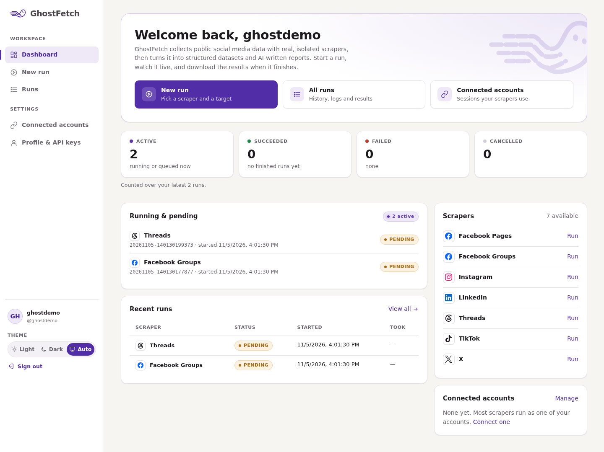
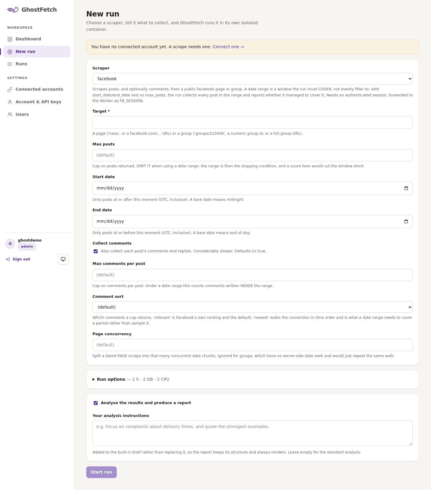
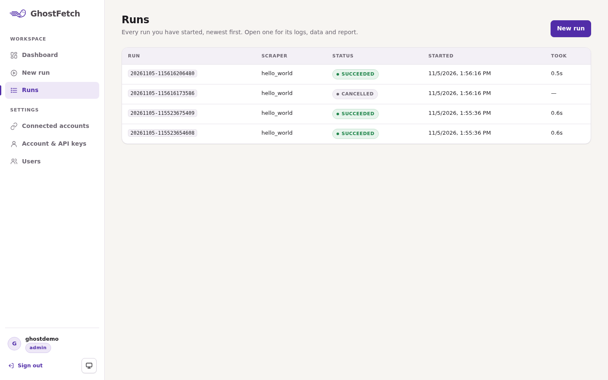

# GhostFetch


GhostFetch collects public social-media posts and comments, turns them into
statistics, has Claude analyse them, and produces a text report, a PDF and an
interactive HTML dashboard. It covers Facebook (pages and groups), Instagram,
TikTok, LinkedIn, X, Threads and YouTube.

> **This is the public demo build.** The real scrapers are not published.
> Each collector here keeps its original API but returns **synthetic data** for
> a fictional brand, generated offline by [`collectors/demo.py`](collectors/demo.py).
> Everything downstream of the collectors is the real code: the processors, the
> Claude analysis, the report generators, and the whole multi-user web platform.
> Nothing in this repository contacts a social network.



## What's in it

It comes in two forms that share the same collectors:

| | What it is | Start here |
|---|---|---|
| **The pipeline** (repo root) | A command-line tool: `python3 main.py <platform> ...` | this README |
| **The platform** (`actor-platform/`) | A self-hosted web app (FastAPI + PostgreSQL + Docker worker + React console) that runs each collector as a containerised "Actor" for many users | [`actor-platform/README.md`](actor-platform/README.md) |

```
Collector (demo: synthetic data)  ->  raw JSON
Processor (stats, no AI)          ->  processed JSON
ai/claude.py                      ->  structured analysis (offline fallback without a key)
ai/segmentation.py                ->  per-post / per-comment topic + sentiment
reports/                          ->  text + PDF + HTML dashboard
notifications/gmail.py            ->  optional e-mail
```

Highlights of the code that is here:

- **One analysis and report layer for six platforms.** Every processor emits the
  same document shape, so the Claude prompts, the PDF and the dashboard are
  written once. Arabic text is shaped correctly in the PDF.
- **Date windows done carefully** ([`collectors/daterange.py`](collectors/daterange.py)):
  a window is something a run must *cover*, and a run that stops short says so.
- **A multi-tenant execution platform**: per-user ownership enforced in every
  query, AES-GCM-encrypted session storage, scoped API keys, invite-only
  sign-up, sign-in throttling, a filesystem or Redis job queue with
  at-least-once delivery, stranded-run recovery, and Actor containers with no
  capabilities, per-run CPU/memory/time limits and no access to each other.
- **A React console** whose run form is generated from each Actor's JSON schema.

## What the demo build changes

| | Full build | Demo build |
|---|---|---|
| Collectors | Playwright / HTTP scrapers per site | [`collectors/demo.py`](collectors/demo.py): deterministic synthetic posts and comments in each platform's real raw-JSON shape |
| *Connect account* | A login browser on the server, streamed into the page over noVNC | Connects a demo account at once and stores an encrypted **placeholder** session through the real storage path |
| CAPTCHA rescue | A run could pause and stream its browser for a person to solve a challenge | Removed |
| Claude analysis | Always calls the API | Calls the API when `ANTHROPIC_API_KEY` is set; otherwise a clearly labelled offline keyword analysis ([`ai/demo_analysis.py`](ai/demo_analysis.py)) |
| YouTube | YouTube Data API | Synthetic videos and comments |

## Quick start: the pipeline

Requires Python 3.13. No API key, account or network access is needed.

```bash
python3 -m venv .venv
.venv/bin/pip install -r requirements.lock.txt
python3 main.py facebook --page lumen --posts 8 --comments 10 --no-email
```

The PDF and dashboard are written to `reports/output/`. Other examples:

```bash
python3 main.py                                   # interactive menu
python3 main.py instagram --profile lumen --posts 10 --no-email
python3 main.py x --profile lumen --start-date 2026-09-01 --end-date 2026-09-30 --no-email
python3 main.py linkedin --company lumen --posts 10 --no-email
python3 main.py youtube
```

To get the real Claude analysis on the demo data, copy `.env.example` to `.env`
and set `ANTHROPIC_API_KEY`.

## Quick start: the platform

Requires Docker (your user in the `docker` group), Node 22 and Python 3.13.

```bash
cd actor-platform
python3 -m venv .venv && .venv/bin/python -m pip install -r requirements.lock.txt
cp .env.example .env.local && chmod 600 .env.local   # fill in every REPLACE_ME
./run-local.sh                                       # database, migrations, console, API, worker
```

Open http://127.0.0.1:8000, sign up, then *Connected accounts -> Connect*
(instant in the demo) and start a run. The first admin is promoted with
`UPDATE users SET is_admin = true WHERE username = '...'`, or with the operator
key (`POST /admin/users/{id}/promote`). `./run-local.sh stop` stops the API and
worker. The API listens on 127.0.0.1 only by default.

<p>


</p>

## Tests

The tests are plain scripts; one runner groups them by what they need:

```bash
python3 scripts/run_tests.py --list
python3 scripts/run_tests.py                       # offline: no network, DB or Docker
ACTOR_PLATFORM_DATABASE_URL=postgresql://...throwaway... \
ACTOR_PLATFORM_SECRET_KEY=... python3 scripts/run_tests.py --group db
python3 scripts/run_tests.py --group docker        # builds and runs the Actor images
```

[`test_demo_pipeline.py`](test_demo_pipeline.py) runs every platform end to end
(collect, process, analyse, segment, render text/PDF/HTML) with sockets blocked,
so it also proves the demo build makes no network request.
`actor-platform/test_accounts.py` covers the demo *Connect* flow against a real
database: the placeholder session is sealed, decrypts, and unlocks a run.

CI ([`.github/workflows/ci.yml`](.github/workflows/ci.yml)) runs ruff, mypy, the
console build, the offline and database suites and a dependency audit on every
push and pull request; the Docker suites run on demand.

The type check is mypy at its default strictness, run against each half's own
virtualenv:

```bash
pip install mypy==2.4.1
python3 scripts/type_check.py
```

## Configuration

| File | Used by | Holds |
|---|---|---|
| `.env` ([example](.env.example)) | the pipeline | optional `ANTHROPIC_API_KEY`, optional Gmail settings |
| `actor-platform/.env.local` ([example](actor-platform/.env.example)) | the platform | encryption key, database URL and password, operator keys, limits |
| `actor-platform/config/actors.json` | the platform | per-Actor policy: sessions, concurrency and run limits |

Both env files are gitignored and should be mode 600; `run-local.sh` enforces
that.

## Licence

Proprietary. All rights reserved; see [LICENSE](LICENSE).
